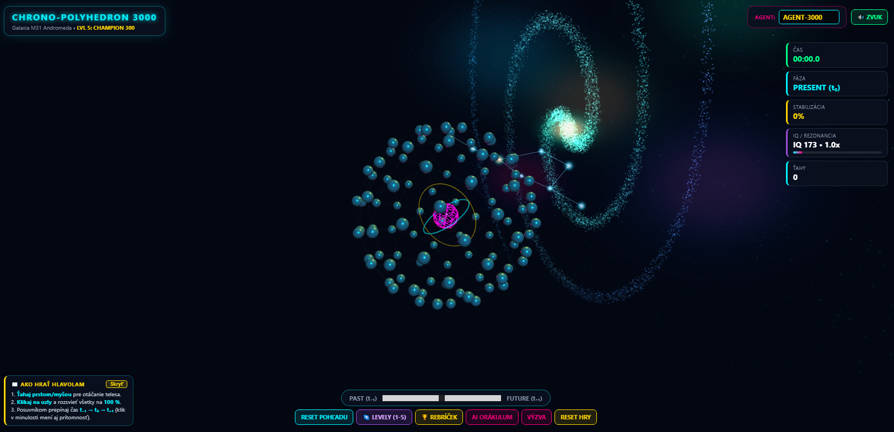

<div align="center">

# 🌌 CHRONO-POLYHEDRON 3000: Supernova Edition

**Futuristický 3D kvantový hlavolam zasadený do hlbokého vesmíru s galaxiou Andromeda (M31), poháňaný cez Three.js, WebGL a Web Audio API.**

[](https://vladimir190-cmyk.github.io/chrono/)
[](https://threejs.org/)
[](https://vladimir190-cmyk.github.io/chrono/)

</div>

---

<p align="center">
  
</p>

---

## 📌 O projekte
**CHRONO-POLYHEDRON 3000** je pokročilá open-source webová 3D hra a priestorový logický hlavolam bežiaci priamo vo webovom prehliadači bez nutnosti inštalácie. 

Hra prepája 3D geometriu s nelineárnou mechanikou cestovania v čase. Hráč manipuluje s trojrozmernými mnohostenmi (polyédrami) a prepína medzi tromi časovými dimenziami:
* **Minulosť ($t_{-1}$)**
* **Prítomnosť ($t_0$)**
* **Budúcnosť ($t_{+1}$)**

Každý zásah v minulosti vyvoláva kaskádovú kvantovú rezonanciu, ktorá okamžite mení stav uzlov v prítomnosti a budúcnosti. Cieľom je stabilizovať všetky uzly naprieč všetkými časovými líniami na **100 %**.

---

## ✨ Kľúčové vlastnosti & Novinky
* **5 úrovní náročnosti (až do 300 uzlov):**
  * *Lvl 1: Tetraéder* (12 uzlov) – tréning časových fáz
  * *Lvl 2: Oktaéder* (18 uzlov) – krížové väzby
  * *Lvl 3: OMEGA Ikosaéder* (36 uzlov) – súťažný mód
  * *Lvl 4: SINGULARITY* (60 uzlov) – dvojitá časová rezonancia
  * *Lvl 5: CHAMPION HYPER-SPHERE 300* (300 uzlov) – majstrovská výzva s Fibonacciho sférickou distribúciou
* **Vizuálny engine & Andromeda M31:** 8 000 procedurálne generovaných hviezd špirálovej galaxie Andromeda, dynamické hmloviny, časticové explózie, gyro-kruhy a laserové prepojenia.
* **Vesmírny Web Audio syntetizátor:** Generovanie ambientného vesmírneho podmazu a frekvenčných posunov v reálnom čase podľa aktuálnej časovej fázy.
* **Mobilná optimalizácia & Presný dotyk:** Čistý stred obrazovky bez prekrývania HUD prvkami a inteligentný *proximity raycasting*, ktorý presne deteguje aj husté uzly pri dotyku prstom.
* **Gamifikácia & 3D Certifikáty:** Speedrun stopky, výpočet *Brain Strain IQ* ratingu, lokálny rebríček šampiónov a generovanie **SHA-256 verifikovaného 3D holografického certifikátu** na stiahnutie vo formáte PNG.
* **PWA (Progressive Web App):** Plne inštalovateľná ako natívna aplikácia na desktop aj mobil.
* **Bezpečnostná architektúra:** Zabudovaná anti-debugging ochrana proti neoprávnenému zásahu cez DevTools a štrukturálna obfuskácia klientskeho kódu.

---

## 🎮 Ovládanie
* **Otáčanie 3D telesa:** Ťahanie myšou alebo prstom po obrazovke.
* **Aktivácia uzla:** Kliknutie / ťuknutie na uzol (rozsvieti uzol v aktuálnej časovej fáze).
* **Cestovanie v čase:** Posuvník v spodnej časti obrazovky (`PAST t₋₁` ↔ `PRESENT t₀` ↔ `FUTURE t₊₁`).

---

## 🛠️ Technický stack
* **3D Grafika:** Three.js (r128) / WebGL
* **Audio:** Web Audio API (oscilátory a filtre v reálnom čase)
* **Frontend & Architektúra:** HTML5, CSS3 (responzívny HUD layout), Vanilla JavaScript (ES6+)
* **Hosting:** GitHub Pages

---

## 🌐 Odkazy a spustenie
* **Hrať naživo:** [https://vladimir190-cmyk.github.io/chrono/](https://vladimir190-cmyk.github.io/chrono/)
* **Zdrojový kód:** [https://github.com/vladimir190-cmyk/chrono](https://github.com/vladimir190-cmyk/chrono)

### Lokálne spustenie
```bash
git clone [https://github.com/vladimir190-cmyk/chrono.git](https://github.com/vladimir190-cmyk/chrono.git)
cd chrono
# Otvorte súbor index.html v prehliadači alebo cez lokálny server (napr. VS Code Live Server)





 
